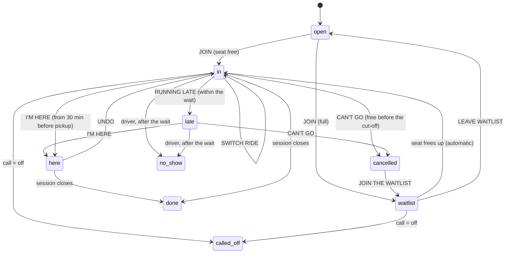

# Plan B · when life happens (Hi8ctane 2.4)

Riders run late, cancel, don't show; drivers drop out; the wind dies; nobody joins. 2.4 handles all of it with one tap and no group-chat drama, using the same crew card everywhere (Home, the landing deck, the crew page). The rules below are defaults the host can change when starting a crew (prototype B24-H25b, "We handle the awkward stuff").

Everything here is built and tested in the database (`schema.sql`, `test/run.sh`) and mirrored for the app in `plan-b/booking.ts` (`node --test "plan-b/*.test.ts"`). Pictures: `screens/plan-b/plan-b-card-states.png` and `plan-b-what-if.png`.

## The rules

| Rule | Default | Host can set | Why |
|---|---|---|---|
| Go/no-go call | 3 h before the start. Sessions before 10:00: 20:00 the evening before | — (host can override the call until the first car leaves) | One decision for everyone, no debate in the chat |
| Free cancel | Until 2 h before the start. Sessions before 10:00: 21:00 the evening before | 1, 2 or 3 h | Riders get an hour after the call to drop out for free |
| Pickup wait | 10 min after the car's departure time | Driver: 5, 10 or 15 min per car | Drivers know exactly how long they wait |
| Waitlist | On. First come, first served. A free seat goes to #1 automatically | On / off | Nobody is left short; drivers don't chase anyone |
| Nobody joins | At the call, a crew of one merges into the closest crew: same sport and day, start within 90 min, spots within 15 km | Merge on / off | Lonely crews become real crews |
| Check-in | "I'M HERE" from 30 min before pickup (or the start) until 3 h after the start. Drivers can check in riders they picked up | — | Show-up is measured, and rewarded |
| Points | +15 checked in · +10 driver with a checked-in rider · −10 late cancel nobody took over · −30 no-show · −20 driver who drops after the call | — | Reliability without money on day one |
| Repeat no-shows | 2+ no-shows in 60 days: confirm the seat before the call, or it goes to the waitlist (free) | — | Protects crews without banning anyone |
| Cost split | Per car: fuel (round-trip km × €0.13) + parking, shared by everyone in the car including the driver. One-way riders pay half the fuel share | Driver: €/km up to €0.25, parking | Fair, and cost-sharing only (see Money) |
| Price freeze | At the cut-off (or when the car leaves, if earlier). After it, a rider's price can only go down | — | Drivers never pay more than the split they agreed; riders never get a surprise |

Times are Amsterdam time; the clocks-go-back night (25 Oct 2026) is tested.

## What happens, case by case

| Case | Rider or driver taps | The app does | Who hears it | Money | Points |
|---|---|---|---|---|---|
| Running late, within the wait | RUNNING LATE → 5 / 10 MIN | Car waits until pickup + minutes; ETA on the driver's screen; one line in the crew chat | Driver (push), crew (chat) | — | — |
| Running late, beyond the wait | RUNNING LATE → MORE | Shows the next car with a free seat and its price: SWITCH RIDE or I'LL MAKE IT (= late by the max wait) | Old driver if they switch | Before the cut-off: free. After it: the old share counts unless someone takes the seat | — |
| Can't go, before the cut-off | CAN'T GO → YES, CANCEL | Seat goes to waitlist #1 automatically | Driver, the promoted rider (push) | Free | — |
| Can't go, after the cut-off | CAN'T GO → YES, CANCEL (the question says the share still counts) | Seat offered to the waitlist at once | Driver | Owes the frozen share unless the seat is taken; whoever takes it takes over that share | −10 if nobody took the seat |
| Seat frees up | — | Waitlist #1 gets it automatically, with a push | Promoted rider, driver | Before the freeze: live split. After: takes over the leaver's share | — |
| No-show | Driver: NO-SHOW on the rider, only after the wait | Rider marked no-show, can dispute within 24 h | Rider | Share counts | −30 |
| Driver can't drive | CAN'T DRIVE | Car cancelled; each rider moved to the car leaving closest to their old pickup, else to the front of the waitlist; they see the new price | Riders (push) | Nobody pays this driver | −20 if after the call |
| Wind drops | — (system at the call) or host | Called off: everyone released, cars cancelled, one message | Everyone (push + chat) | Nobody pays | — |
| Wind is good | — (system at the call) or host | IT'S ON message with the reason ("21 kt at 14:00") | Everyone | — | — |
| Nobody joins | — (system at the call) | Merged into the closest crew; host told | Host, members | — | — |
| At the spot | I'M HERE (or the driver checks you in) | Booking = here | — | — | +15 after the session |
| After the ride | — | Session closes 4 h after the start; "pay after" message with the amount and who to pay | Riders with a share | Day one: settled outside the app, driver ticks PAID | — |

The go/no-go call uses the cached forecast for the first 3 hours: GO when at least 2 hours are usable (kite 15–30 kt, wing 14–25 kt, gusts under mean + 10, wind direction inside the spot's arc; surf 1.0 m+ with wind 14 kt or less; SUP 8 kt or less; MTB 5 mm of rain or less in the last 24 h). No forecast → the host is asked to call it. The host can flip the call until the first car leaves.

## States



Stored in `crew_members.booking`: `in, late, here, cancelled, waitlist, no_show, done, called_off` ("open" = no row). The questions on the card (how late? / too late / cancel for sure?) are screen state only.

## Where it shows up in the app

- **Crew card** (Home, landing deck, top of the crew page): JOIN · price / SAVE → YOU'RE IN · pickup → RUNNING LATE / CAN'T GO, and I'M HERE once check-in opens. Bars: lime = in or checked in, yellow = late, grey = cancelled, white = waitlist. Copy in `plan-b/booking.ts` → `view()`.
- **Crew page · the road trip** (screen 02): cars as rows of seats; tap an empty seat to take it; full → "NO SEAT FITS?" puts you on the waitlist; the ride back (same car / staying later = one-way / own way).
- **Driver view** (crew page, own car): riders with live ETA, NO-SHOW (enabled after the wait), PICKED UP (checks the rider in), CAN'T DRIVE, PAID ticks after the ride.
- **Start a crew** (screen 10, as in B24-H25b): sport → day (each day shows its forecast, BEST badge) → how you get there; the rules panel with tap-to-change values.
- **I'm in · getting there** (screen 05): I DRIVE asks seats, boards, max wait, pickup point and time; km comes from the route, parking from the spot.
- **After the ride**: one card with what you owe and to whom, and SEND A PAYMENT REQUEST for drivers.

## Notifications

| Kind | To | When | Channel | Example |
|---|---|---|---|---|
| late | driver | rider taps late | push + chat line | "Sam is running 8 min late. Marta waits till 12:23." |
| cancelled | driver | rider cancels or switches | push + chat | "Lena can't make it." |
| promoted | waitlisted rider | seat freed | push (urgent) | "You're in: seat in Marta's car, 12:15 Sloterdijk P+R." |
| seat_refilled | driver | seat refilled | push | "Kim takes the free seat. Your split stays €4.08." |
| call_go / call_off | everyone | at the call | push + chat (+ email for off) | "IT'S ON: 21 kt at 14:00." / "Called off: 12 kt. Nobody drives, nobody pays." |
| call_needed | host | no forecast at the call | push | "Make the call for Wijk aan Zee 14:00." |
| alone | host | crew of one at the call, nothing to merge with | push | "Nobody joined yet. Ride solo or call it off." |
| merged | members | merge | push | "Your crew joined the 14:00 Wijk aan Zee crew." |
| driver_dropped / moved_car | riders | driver can't drive | push | "Marta can't drive. You're in Joost's van, 12:40, €4.49." |
| no_show | rider | driver marks it | push + email | "Marked as a no-show. €4.08 counts. Wrong? Tell us within 24 h." |
| cutoff_soon | riders | 30 min before the cut-off | push | "Free cancel ends at 12:00. Still in?" |
| pickup_soon | riders | 45 min before pickup | push | "Pickup 12:15 at Sloterdijk P+R. Running late? One tap." |
| confirm_needed | repeat no-shows | 2 h before the call | push | "Confirm your seat before 11:00." |
| pay_after | riders with a share | session closes | push + email | "Back? You owe Marta €4.08." |

Rows land in `notifications` (the outbox). A worker sends unsent rows (`sent_at is null and send_after <= now()`) as web push, falling back to email, and re-checks that the booking is still active before sending reminders. Chat lines are written straight into `messages` as `kind = 'system'`. Web push on iPhone needs the app added to the Home Screen (iOS 16.4+): ask right after the first join. Keep WhatsApp for sharing crew links on day one; WhatsApp Business messages are billed per message.

## Server

All state changes go through these functions (`supabase.rpc(name, args)`); direct writes to bookings, cars, points and calls are revoked.

| RPC | When |
|---|---|
| `start_crew(sport, spot, starts_at, ride, …rules)` | Start a crew (adds the host) |
| `join_crew(crew, ride, car?, pickup?, one_way?)` | I'M IN; returns `in` or `waitlist` |
| `offer_car(crew, leaves_at, pickup_point, seats, round_trip_km, parking_eur, board_slots?, max_wait_min?)` | I DRIVE (also edits the car; new seats go to the waitlist) |
| `running_late(crew, minutes)` | 5 / 10 / MORE; returns `covered`, or `too_late` with alternatives |
| `switch_car(crew, car)` | SWITCH RIDE |
| `check_in(crew, rider?)` / `undo_check_in(crew)` | I'M HERE / UNDO; the driver passes `rider` |
| `cancel_booking(crew)` | CAN'T GO; returns `free` and `owes_eur` |
| `join_waitlist(crew)` / `leave_waitlist(crew)` / `confirm_seat(crew)` | Waitlist and repeat-no-show confirm |
| `mark_no_show(crew, rider)` | Driver, after the wait |
| `driver_cant_drive(crew)` | CAN'T DRIVE |
| `make_call(crew, 'go' or 'off', reason?)` | Host override |
| `merge_candidates(crew)` / `merge_crew(from, into)` | Host merges by hand |
| `mark_paid(crew, rider)` | Driver ticks PAID |
| `split_shares(car)`, views `car_seats`, `crew_seats`, `reliability` | Read the split, seats and points |

**The clock.** `plan_b_tick()` freezes splits at the cut-off, releases unconfirmed seats, makes the calls and merges, queues reminders, and closes sessions (points, pay-after). Run it every minute with Supabase Cron:

```sql
select cron.schedule('plan-b-tick', '* * * * *', 'select plan_b_tick()');
```

Vercel Hobby can't do this: Hobby cron jobs run at most once a day (and the 2.2 hourly forecast job needs the same fix: schedule it from Supabase Cron with `pg_net`, or move to Vercel Pro).

## Money

- **Day one: no money in the app.** The card shows the split before you join; after the ride you see who to pay; the driver sends a payment request (bank app or Tikkie) or takes cash and ticks PAID. No account or card needed to join, which keeps the guest invite flow intact.
- **Cost-sharing only.** Dutch law (Wet personenvervoer 2000, art. 2) leaves transport out of the taxi rules when all payments for the trip stay within the car's costs plus extra trip costs and it isn't done as a business. Our split covers fuel and parking only, below that ceiling; never let drivers set a price.
- **Later: pay after in the app.** Needs a payment provider with payouts to drivers (driver onboarding and ID checks) and a card or iDEAL on file to collect no-show shares. Fees matter at this size: iDEAL costs about €0.32 per payment, so batch a rider's shares per week or month rather than charging every ride. Decision for Francisco: see PAYMENTS.md.

## Edge cases

- Someone cancels and later re-joins: treated as a new join (a new seat, or the waitlist).
- A driver adds seats after the freeze: new riders lower everyone's price; nobody's goes up.
- A late cancel and a new rider in the same car: the new rider takes over the late cancel's share first.
- Waitlisted riders are seated in a car that leaves after "now" only; once a car has left, its free seat stays free.
- Displaced riders (driver dropped) go ahead of people who joined the waitlist later.
- The host leaves: hand the host role to the earliest driver (not built yet; today the host's crew stays and the call still runs).
- A call can't be switched to OFF once a car has left; the session just ends.
- A crew is moved to another time (next drop, "MOVE IT"): everyone gets a free cancel.
- Guests (no account) get points and no-shows like anyone; their WhatsApp number is their identity until they sign in.

## Prototype vs this spec

Build the spec where they differ:

1. Morning sessions: the prototype says the call and the free cancel both end at 21:00; the spec calls at 20:00 so riders get an hour.
2. The deck's MTB card says "FREE CANCEL TILL FRI" for a Saturday 10:30 ride; the rule gives Saturday 08:30.
3. "Your price stays €4.08" is true when the seat is refilled. The promise that always holds: after the cut-off your price can only go down.
4. I'M HERE appears in the normal "you're in" state once check-in opens (the prototype only shows it after RUNNING LATE).
5. After SWITCH RIDE the card's driver line and avatars switch to the new car.
6. "Pay after the ride, in one tap" (H24b, H26b) needs in-app payments. Until then say "settle up after the ride".
